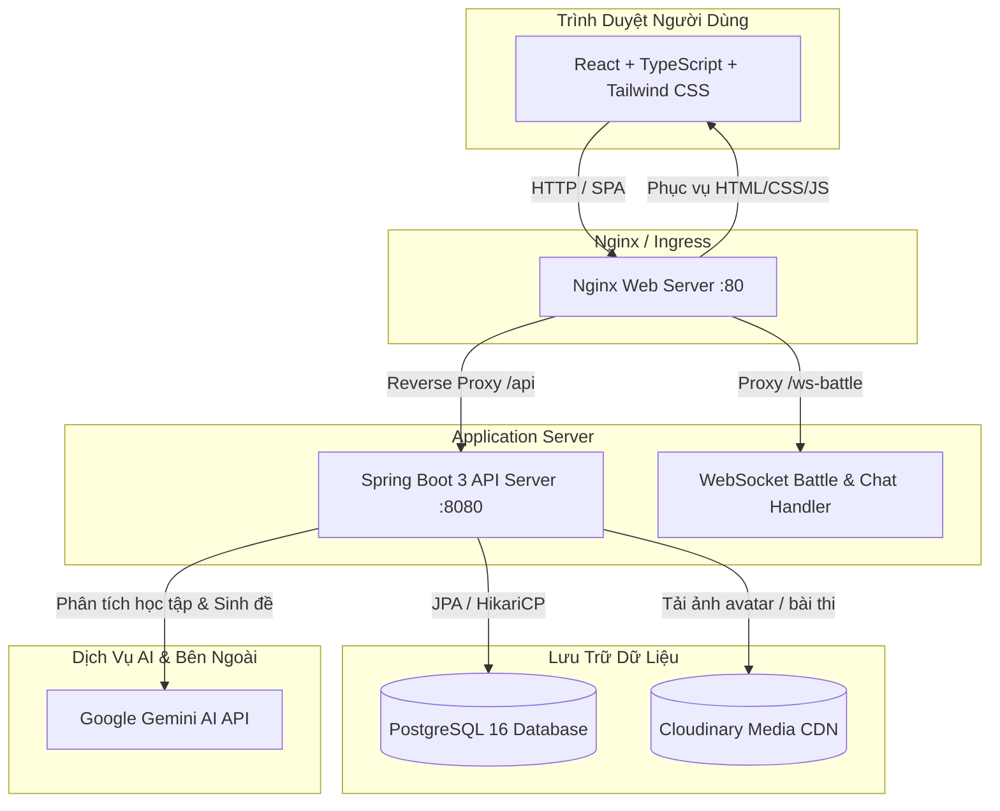

# 🎓 StudentQuizz — Nền Tảng Trắc Nghiệm Trực Tuyến & Ôn Luyện Tích Hợp AI

[](https://spring.io/projects/spring-boot)
[](https://react.dev/)
[](https://www.typescriptlang.org/)
[](https://vitejs.dev/)
[](https://www.docker.com/)
[](https://github.com/features/actions)
[](https://www.postgresql.org/)

Hệ thống thi trắc nghiệm trực tuyến fullstack dành cho học sinh, sinh viên với các tính năng hiện đại: tự động tạo đề và gợi ý ôn tập thông minh bằng **Google Gemini AI**, chế độ đấu đối kháng thời gian thực qua **WebSocket**, diễn đàn thảo luận trao đổi tài liệu, cùng bảng xếp hạng và hệ thống huy hiệu gamification.

---

## 🏛️ Sơ Đồ Kiến Trúc Hệ Thống (Architecture)



---

## 🚀 Tính Năng Nổi Bật

* **Học tập & Luyện thi thông minh**:
  * Đa dạng chủ đề, phân loại theo danh mục và độ khó.
  * Tự động chấm điểm, phân tích chi tiết kết quả từng câu hỏi.
* **Tích hợp Google Gemini AI**:
  * Tự động phân tích điểm yếu học tập sau các lượt làm bài, đề xuất lộ trình cải thiện cá nhân hóa.
  * Tự động sinh đề thi trắc nghiệm chuẩn cấu trúc từ tài liệu hoặc chủ đề bất kỳ.
* **Đấu trí Realtime (Battle Mode)**:
  * Tranh tài trực tiếp 1v1 hoặc nhiều người chơi thông qua WebSocket STOMP.
* **Mạng xã hội & Thảo luận**:
  * Diễn đàn hỏi đáp sinh viên, hỗ trợ đính kèm hình ảnh và tài liệu học tập qua Cloudinary.
  * Kết bạn, trò chuyện trực tuyến, xem hồ sơ cá nhân.
* **Gamification**:
  * Bảng xếp hạng tuần/tháng, hệ thống huy hiệu và danh hiệu vinh danh người học chăm chỉ.

---

## 🛠️ Công Nghệ Sử Dụng (Tech Stack)

| Lớp (Layer) | Công nghệ |
| :--- | :--- |
| **Backend** | Java 17, Spring Boot 3.5, Spring Security, Spring Data JPA, Hibernate, WebSocket |
| **Frontend** | React 18, TypeScript, Vite, Tailwind CSS, Lucide React, Axios |
| **Database** | PostgreSQL 16 (Production) / H2 Database (Local Dev) |
| **AI Integration** | Google Gemini Generative Language API (`gemini-3.6-flash`, `gemini-flash-latest`) |
| **Cloud Storage** | Cloudinary API (Lưu trữ ảnh đại diện, ảnh câu hỏi, ảnh đính kèm diễn đàn) |
| **DevOps & Deploy** | Docker, Docker Compose, Nginx, GitHub Actions CI/CD |

---

## ⚡ Hướng Dẫn Chạy Nhanh với Docker Compose (Khuyên dùng)

### 1. Yêu cầu hệ thống
* Đã cài đặt [Docker](https://docs.docker.com/get-docker/) và [Docker Compose](https://docs.docker.com/compose/).

### 2. Khởi chạy toàn bộ hệ thống
```bash
# 1. Clone repository
git clone https://github.com/TrungChien05/student-quiz-fullstack.git
cd student-quiz-fullstack

# 2. Tạo file biến môi trường từ mẫu
cp .env.example .env

# 3. Khởi chạy Database, Backend và Frontend bằng một lệnh duy nhất
docker compose up -d --build
```

* **Frontend Web**: Truy cập tại `http://localhost` (Port 80)
* **Backend API**: Truy cập tại `http://localhost:8080/api`
* **PostgreSQL**: Chạy ngầm tại `localhost:5432`

---

## 💻 Chạy Trong Môi Trường Phát Triển Thủ Công (Local Development)

### 1. Chạy Backend
Yêu cầu: JDK 17+ và Maven.
```bash
cd backend
# Chạy Spring Boot (mặc định dùng H2 Database in-memory / file, không cần cài PostgreSQL)
./mvnw spring-boot:run
```
> H2 Database Console có thể truy cập tại `http://localhost:8080/h2-console` (JDBC URL: `jdbc:h2:file:./data/studentquizz`).

### 2. Chạy Frontend
Yêu cầu: Node.js 18+ và npm.
```bash
cd frontend
npm install
npm run dev
```
> Giao diện dev Vite sẽ chạy tại `http://localhost:5173`.

---

## 🔐 Cấu Hình Biến Môi Trường (Environment Variables)

Dự án cung cấp sẵn tệp mẫu [`.env.example`](file:///.env.example):

| Tên biến | Mô tả | Mặc định |
| :--- | :--- | :--- |
| `POSTGRES_DB` | Tên cơ sở dữ liệu PostgreSQL | `studentquizz` |
| `POSTGRES_USER` | Tên tài khoản quản trị CSDL | `postgres` |
| `POSTGRES_PASSWORD` | Mật khẩu tài khoản CSDL | `postgres_password` |
| `JWT_SECRET` | Khóa bí mật ký mã hóa JWT token (tối thiểu 256 bits) | Dev secret key |
| `GEMINI_API_KEY` | API Key của Google AI Studio để gọi Gemini AI | *(Để trống nếu không dùng AI)* |
| `CLOUDINARY_CLOUD_NAME`| Tên cloud trên Cloudinary để upload ảnh | Configured |
| `CLOUDINARY_API_KEY` | API Key của Cloudinary | Configured |
| `CLOUDINARY_API_SECRET`| API Secret của Cloudinary | Configured |

---

## 🔄 CI/CD Pipeline (GitHub Actions)

Dự án được tích hợp sẵn quy trình CI tại [`.github/workflows/ci.yml`](file:///.github/workflows/ci.yml):
* **Backend Build**: Tự động cài đặt Java 17, kiểm tra biên dịch Spring Boot với Maven.
* **Frontend Build**: Tự động cài đặt Node 20, kiểm tra TypeScript compile và Vite build.
* **Docker Verification**: Kiểm tra quá trình đóng gói Docker image cho cả 2 dịch vụ, đảm bảo code đẩy lên luôn sẵn sàng deploy.

---

## 📂 Cấu Trúc Thư Mục (Project Structure)

```text
student-quiz-fullstack/
├── .github/workflows/        # Cấu hình GitHub Actions CI/CD Pipeline
├── backend/                  # Mã nguồn Spring Boot 3 (API REST, WebSocket, JPA)
│   ├── src/                  # Controllers, Services, Models, Repositories
│   ├── Dockerfile            # Multi-stage Docker build cho Spring Boot
│   └── pom.xml               # Danh sách thư viện Maven
├── frontend/                 # Mã nguồn React 18 + TypeScript + Vite
│   ├── src/                  # Components, Pages, Services, Hooks
│   ├── nginx.conf            # Cấu hình Nginx phục vụ SPA & Reverse Proxy
│   ├── Dockerfile            # Multi-stage Docker build cho Frontend
│   └── package.json          # Danh sách thư viện npm
├── scripts/                  # Scripts kiểm tra API và seed dữ liệu
├── docker-compose.yml        # Orchestration cho Postgres, Backend, Frontend
├── .env.example              # Mẫu biến môi trường Docker Compose
└── README.md                 # Tài liệu hướng dẫn dự án
```

---

## 📜 Giấy phép & Tác giả
* **Tác giả**: [TrungChien05](https://github.com/TrungChien05)
* Dự án phát triển phục vụ mục đích học tập, nghiên cứu công nghệ DevOps, Cloud và AI Application.
